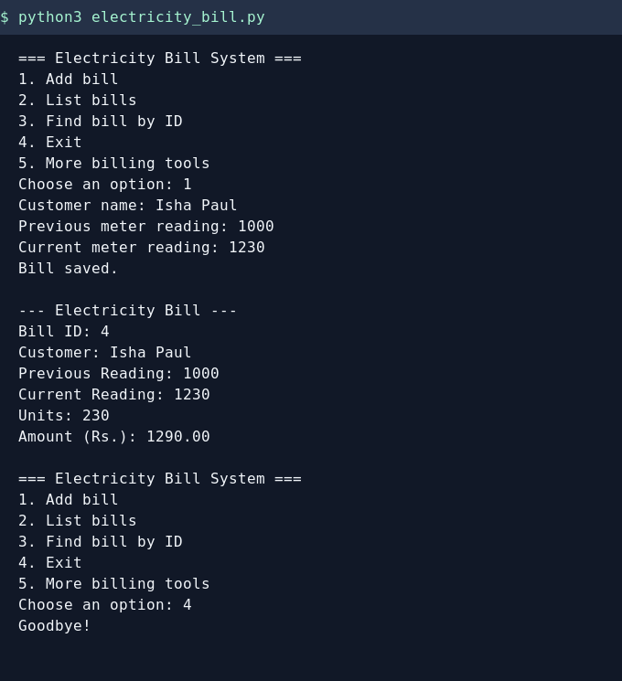

# Electricity Bill System


A command-line Python application that calculates electricity charges from meter readings and stores bills in a local CSV file. The project demonstrates functions, loops, input validation, and file handling at a CBSE Class 12 level. It uses sample rates, not an official utility tariff.

[Quick start](#quick-start) · [Menu reference](#menu-reference) · [Billing rules](#billing-rules) · [Demo walkthrough](#demo-walkthrough) · [Viva preparation](#viva-preparation)

## Quick start

**Requirements:** Python 3 and a terminal. No external packages or database are required. Run the commands from the project folder.

To try the program with three sample bills, copy the demo file before launching. **Skip the copy command if you already have a `bills.csv` you want to keep.** If no `bills.csv` exists, the program creates an empty bill register with column headers.

**macOS / Linux**

```sh
cp demo_bills.csv bills.csv
python3 electricity_bill.py
```

**Windows (Command Prompt)**

```bat
copy demo_bills.csv bills.csv
py -3 electricity_bill.py
```

If `py` is unavailable but `python` opens Python 3, use `python electricity_bill.py` instead.

## Menu reference

| Option | Action | What it does |
| --- | --- | --- |
| 1 | Add bill | Enter a customer name and two meter readings. The program assigns an ID, calculates the charge, and saves the bill. |
| 2 | List bills | Show the ID, customer, units used, and amount for each saved bill. |
| 3 | Find bill by ID | Show a complete bill, including both meter readings. |
| 4 | Exit | Close the program. |
| 5 | More billing tools | Open the submenu below. |

### More billing tools

| Option | Action | What it does |
| --- | --- | --- |
| 1 | Search by customer name | Match all or part of a name, ignoring case. |
| 2 | Correct a saved bill | Keep the bill ID, update the readings and optionally the name, then confirm before saving. |
| 3 | Show billing summary | Show the bill count, total units, total and average charges, and the highest-usage bill. |
| 4 | Estimate a bill | Show a charge breakdown for a number of units without saving a record. |
| 5 | Filter bills by usage | Show bills at or above the entered minimum units. |
| 6 | Back to main menu | Return to the main menu without closing the program. |

## Billing rules

**Units used = current reading − previous reading.** Both readings must be non-negative whole numbers, and the current reading cannot be lower than the previous reading.

| Usage slab | Rate |
| --- | ---: |
| First 100 units | Rs. 4 per unit |
| Next 100 units | Rs. 6 per unit |
| Units above 200 | Rs. 8 per unit |

Rates are applied progressively: only the units in each slab are charged at that slab's rate. Every bill includes a **fixed charge of Rs. 50**, even when usage is zero. For example, 150 units cost `100 × 4 + 50 × 6 + 50 = Rs. 750.00`.

## Demo walkthrough

1. Choose **2** to list the three sample bills.
2. Choose **3** and enter bill ID **2** to retrieve Rohan Das's bill: **150 units, Rs. 750.00**.


3. Choose **1** and enter `Isha Paul`, a previous reading of `1000`, and a current reading of `1230`. With the original demo data, the program saves **bill 4** for **230 units, Rs. 1,290.00**.



4. Exit and restart the program, then choose **3** and enter the new bill ID to confirm it was saved to disk.

## Project files and storage

| File | Purpose |
| --- | --- |
| [`electricity_bill.py`](electricity_bill.py) | Main Python application. |
| [`demo_bills.csv`](demo_bills.csv) | Three sample records for a repeatable demonstration. |
| `bills.csv` | Working file stored beside the script. It is ignored by Git and is the only CSV the program writes to. |
| [`preparation.md`](preparation.md) | Project notes and CBSE viva preparation. |
| [`docs/`](docs/) | Terminal captures and the animated SVG banner. |

Each CSV row stores the bill ID, customer name, previous reading, current reading, units used, and amount in rupees. To reset the demo, close the program, back up your working file if needed, and copy `demo_bills.csv` over `bills.csv`.

## Viva preparation

Read [the viva preparation guide](preparation.md) for project notes, a practical demonstration, and sample questions with answers. Before the viva, practise explaining how the program calculates a charge across multiple slabs, how it reads and writes CSV records, and how it handles invalid meter readings. Then run the walkthrough above without referring to the screenshots.
