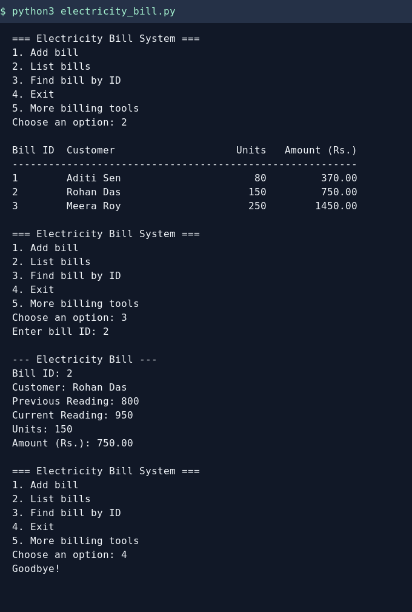

# Electricity Bill System

A 291-line menu-driven Python project for CBSE Class 12. It uses functions, loops, conditionals, and the built-in `csv` module to create, list, and search electricity bills. No third-party packages are needed.

## Run the demo

From the project folder, copy `demo_bills.csv` to `bills.csv` **only if you don't already have a `bills.csv` you want to keep**.

| macOS / Linux | Windows Command Prompt |
| --- | --- |
| `cp demo_bills.csv bills.csv` | `copy demo_bills.csv bills.csv` |
| `python3 electricity_bill.py` | `python electricity_bill.py` |

To start with no sample data, skip the copy step. The program creates `bills.csv` next to the script if it doesn't exist. Changes go to `bills.csv`; the demo file stays untouched.

1. **Add bill:** Enter a customer name and two whole-number meter readings. The program calculates the amount and saves the bill with a new ID.
2. **List bills:** See each saved bill's ID, customer, units, and amount.
3. **Find bill by ID:** Enter an ID to see the full bill, including both readings.
4. **Exit:** Close the program.
5. **More billing tools:** Search by customer name, correct a saved bill, view totals and average charges, estimate a bill without saving, or filter bills by minimum usage.

## How the amount is calculated

Units used = current reading − previous reading. The rates below are for this exercise, not an actual electricity tariff.

| Usage block | Rate |
| --- | ---: |
| First 100 units | Rs. 4 per unit |
| Next 100 units | Rs. 6 per unit |
| Units above 200 | Rs. 8 per unit |

Each bill includes a fixed Rs. 50 charge. For example, 150 units cost `100 × 4 + 50 × 6 + 50 = Rs. 750.00`.

## Terminal output

These captures show actual runs with the demo CSV.

### List the demo bills and find bill 2

### Add a new bill

